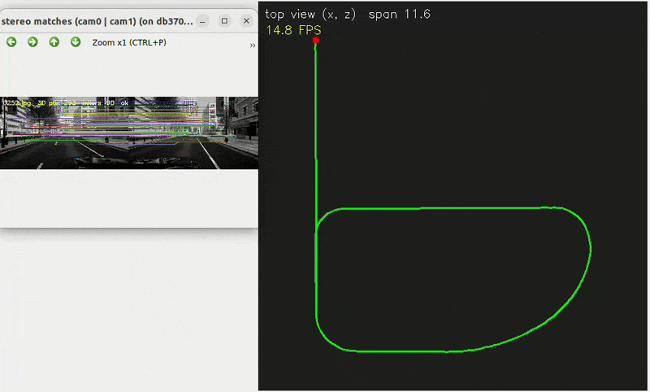

# Colmap-odometry

Visual odometry package built on COLMAP, in three variants:

- **`python/`**: a pycolmap-based VO framework for developing and testing new VO/SLAM features (deep-learning features and matching, keyframe selection, windowed bundle adjustment). It supports monocular, stereo and multi-camera setups.
- **`ros/`**: a ROS 2 (Jazzy) node for frame-to-frame multi-camera odometry. It uses pluggable features and optional IMU priors, publishes the relative motion with its covariance, and comes with a Dockerfile.
- **`c++/`**: a minimal, real-time stereo or monocular VO in C++. It uses ORB or SIFT features (OpenCV), triangulation, and PnP resection (OpenCV or PoseLib), and comes with a Dockerfile.

Each folder has its own README or usage notes.
